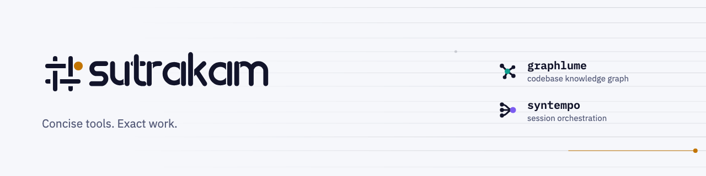
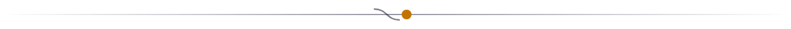
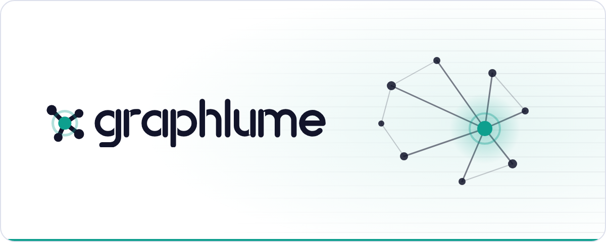
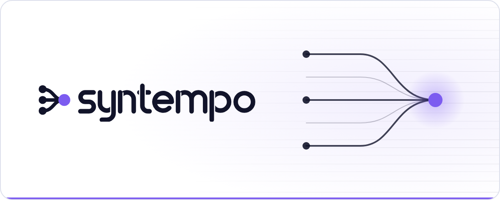

<picture>
  <source media="(prefers-color-scheme: dark)" srcset="https://raw.githubusercontent.com/sutrakam/.github/main/assets/sutrakam-readme-banner-dark-1280x320.png">
  
</picture>

<p align="center">
  <a href="#tools"><b>Tools</b></a>&nbsp;&nbsp;·&nbsp;&nbsp;<a href="#quick-start"><b>Quick start</b></a>&nbsp;&nbsp;·&nbsp;&nbsp;<a href="#how-we-build"><b>How we build</b></a>&nbsp;&nbsp;·&nbsp;&nbsp;<a href="#follow"><b>Follow</b></a>
</p>

<p align="center">
  Focused software tools that work well alone and better together.
</p>

<picture>
  <source media="(prefers-color-scheme: dark)" srcset="https://raw.githubusercontent.com/sutrakam/.github/main/assets/divider-dark.png">
  
</picture>

## Tools

<table>
<tr>
<td width="50%" valign="top">

<a href="https://github.com/sutrakam/graphlume">
<picture>
  <source media="(prefers-color-scheme: dark)" srcset="https://raw.githubusercontent.com/sutrakam/.github/main/assets/card-graphlume-dark.png">
  
</picture>
</a>

**graphlume** &nbsp;`v1.0.0`

Local code knowledge graph and MCP server for AI coding agents. Callers, blast radius, routes, tables and tests, each answer backed by `file:line` evidence and a confidence level. One Go binary, fully offline.

[Repository](https://github.com/sutrakam/graphlume) · [User guide](https://github.com/sutrakam/graphlume/blob/main/docs/USER_GUIDE.md) · [Releases](https://github.com/sutrakam/graphlume/releases)

</td>
<td width="50%" valign="top">

<picture>
  <source media="(prefers-color-scheme: dark)" srcset="https://raw.githubusercontent.com/sutrakam/.github/main/assets/card-syntempo-dark.png">
  
</picture>

**syntempo** &nbsp;*In development*

Deterministic workflow and parallel session orchestrator. Many sessions, one synchronised result.

Not public yet. [Follow along](#follow) to hear when it ships.

</td>
</tr>
</table>

## Quick start

Give your coding agent a map of your code in two commands:

```bash
curl -fsSL https://raw.githubusercontent.com/sutrakam/graphlume/main/install.sh | sh
cd your-project && graphlume init --all
```

Windows, `go install` and Docker options are in the [graphlume README](https://github.com/sutrakam/graphlume#quickstart).

## How we build

<table>
<tr>
<td width="33%" valign="top">

**Local-first**

Your code stays on your machine. The tools run offline, with no account and no cloud service.

</td>
<td width="33%" valign="top">

**Evidence, not guesses**

Every answer points to the exact `file:line` it came from and says how sure it is.

</td>
<td width="33%" valign="top">

**One job, done well**

Small single-binary tools that compose, instead of one platform you have to adopt.

</td>
</tr>
</table>

## The name

*Sutra* is a short, exact rule, and a thread. *Kam* is work. Put together: concise tools, exact work.

<picture>
  <source media="(prefers-color-scheme: dark)" srcset="https://raw.githubusercontent.com/sutrakam/.github/main/assets/divider-dark.png">
  
</picture>

<h2 id="follow" align="center">Follow</h2>

<p align="center">
  <a href="https://x.com/sutrakamhq">X</a>&nbsp;&nbsp;·&nbsp;&nbsp;<a href="https://www.linkedin.com/company/sutrakamhq">LinkedIn</a>&nbsp;&nbsp;·&nbsp;&nbsp;<a href="https://www.instagram.com/sutrakamhq">Instagram</a>&nbsp;&nbsp;·&nbsp;&nbsp;<a href="https://www.facebook.com/sutrakamhq">Facebook</a>&nbsp;&nbsp;·&nbsp;&nbsp;<a href="mailto:hi@satyendra.dev">hi@satyendra.dev</a>
</p>
